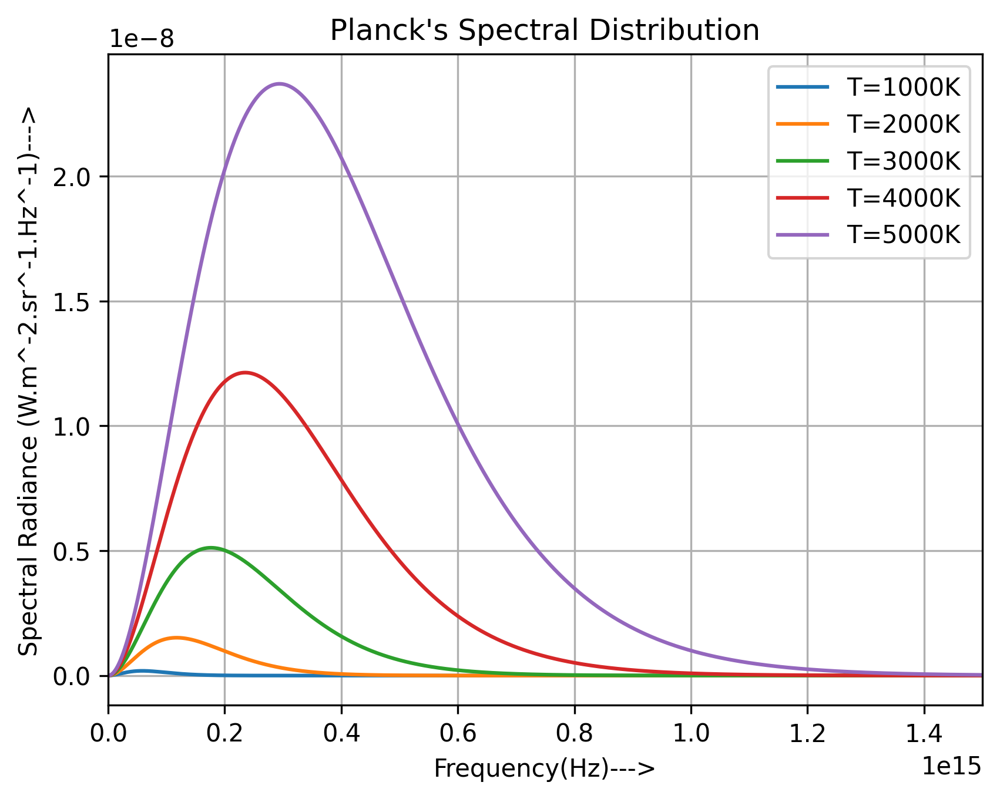
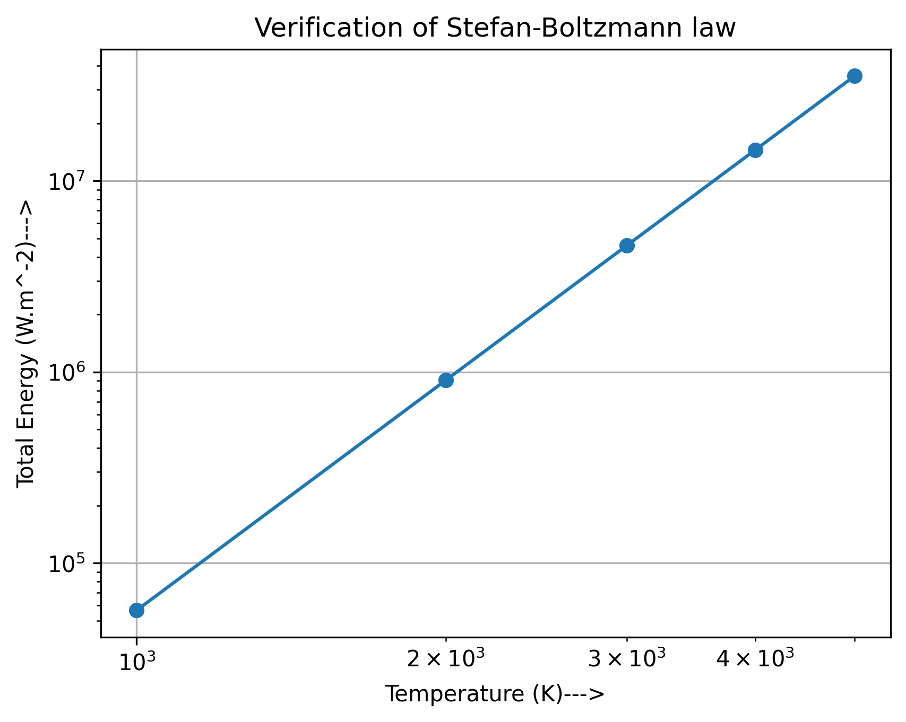
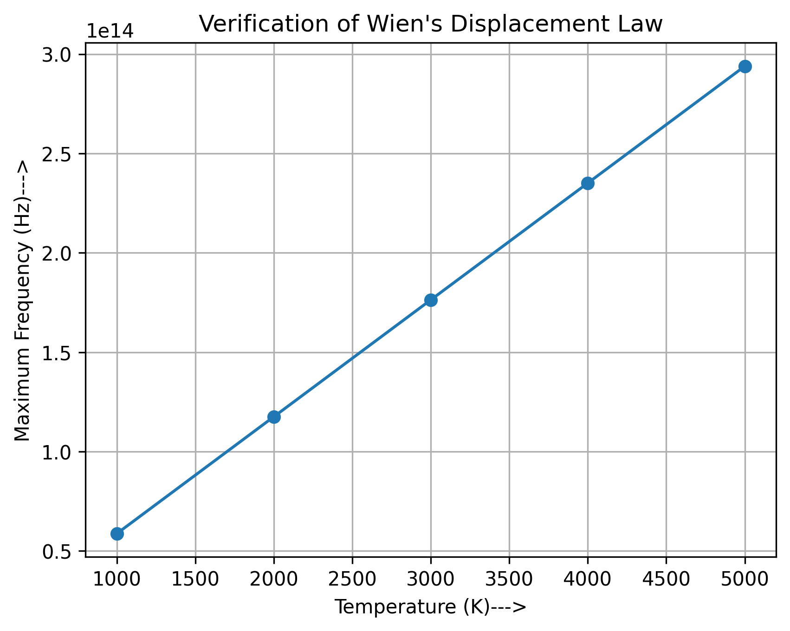

# Blackbody Radiation: From Planck's Law to Classical Radiation Laws

A computational study of thermal radiation from an ideal blackbody. Starting from **Planck's spectral distribution** (the result of quantizing the energy of cavity modes, $E = h\nu$), this project numerically recovers two classical empirical results as *consequences* of the quantum law:

- the **Stefan-Boltzmann law**, $M = \sigma T^4$
- **Wien's displacement law**, $\nu_{\max} \propto T$

The aim is to see how a single microscopic assumption, discrete energy exchange, reproduces macroscopic thermodynamic laws.

---

## 1. Physical Background

### 1.1 The problem: the ultraviolet catastrophe

Treat radiation in a cavity of volume $V$ at temperature $T$ as a gas of standing electromagnetic modes. The number of modes per unit frequency (two polarizations) is

$$
g(\nu)\,d\nu = \frac{8\pi \nu^2}{c^3}\,V\,d\nu .
$$

Classical equipartition assigns each mode an average energy $\langle E \rangle = k_B T$, giving the **Rayleigh-Jeans law**

$$
u_\nu^{\text{RJ}} = \frac{8\pi \nu^2}{c^3}\,k_B T .
$$

This grows as $\nu^2$, so the total energy density $\int_0^\infty u_\nu\, d\nu$ diverges. This failure at high frequency is the *ultraviolet catastrophe*.

### 1.2 Planck's resolution

Planck (1900) postulated that a mode of frequency $\nu$ can only exchange energy in discrete units:

$$
E_n = n h \nu, \qquad n = 0, 1, 2, \dots
$$

Averaging over the Boltzmann distribution $P_n \propto e^{-E_n/k_B T}$ gives

$$
\langle E \rangle = \frac{\sum_n n h\nu\, e^{-n h\nu / k_B T}}{\sum_n e^{-n h\nu / k_B T}} = \frac{h\nu}{e^{h\nu/k_B T} - 1}.
$$

For $h\nu \ll k_B T$ this reduces to $k_B T$ (the classical limit). For $h\nu \gg k_B T$ high-frequency modes are exponentially suppressed, which removes the divergence. The spectral energy density is

$$
u_\nu(T) = \frac{8\pi h \nu^3}{c^3}\,\frac{1}{e^{h\nu/k_B T} - 1}.
$$

### 1.3 Spectral radiance (what the code computes)

The spectral radiance of a blackbody is

$$
B_\nu(T) = \frac{c}{4\pi}\,u_\nu = \frac{2 h \nu^3}{c^2}\,\frac{1}{e^{h\nu/k_B T} - 1}
\qquad [\text{W}\,\text{m}^{-2}\,\text{sr}^{-1}\,\text{Hz}^{-1}].
$$

### 1.4 Stefan-Boltzmann law

The total power emitted per unit area (radiant exitance) is obtained by integrating over frequency and over the outgoing hemisphere (a factor of $\pi$ for a Lambertian emitter):

$$
M(T) = \pi \int_0^\infty B_\nu(T)\, d\nu = \sigma T^4 ,
$$

where, with the substitution $x = h\nu/k_B T$ and $\int_0^\infty \frac{x^3}{e^x - 1}dx = \frac{\pi^4}{15}$,

$$
\sigma = \frac{2\pi^5 k_B^4}{15\, c^2 h^3} \approx 5.670374 \times 10^{-8}\ \text{W}\,\text{m}^{-2}\,\text{K}^{-4}.
$$

On a log-log plot, $\ln M = \ln\sigma + 4\ln T$ is a straight line of slope 4 and intercept $\ln \sigma$.

### 1.5 Wien's displacement law

Setting $\partial B_\nu / \partial \nu = 0$ and writing $x = h\nu/k_B T$ leads to the transcendental equation

$$
(3 - x)\,e^{x} = 3 \quad\Rightarrow\quad x \approx 2.821439,
$$

so

$$
\nu_{\max} = \frac{2.821439\, k_B}{h}\, T \approx 5.879 \times 10^{10}\ \text{Hz}\,\text{K}^{-1} \cdot T .
$$

The peak frequency scales linearly with temperature.

> **Note:** the familiar form $\lambda_{\max} T = 2.898\times10^{-3}\ \text{m K}$ is *not* simply $c/\nu_{\max}$. The peak of $B_\nu$ and the peak of $B_\lambda$ differ because $B_\lambda\, d\lambda = B_\nu\, d\nu$ introduces a Jacobian $|d\nu/d\lambda| = c/\lambda^2$. This project works in frequency space.

---

## 2. What the Code Does

`blackbody_radiation.py` performs three tasks:

1. **Planck spectrum.** Evaluates $B_\nu(T)$ on a frequency grid for $T = 1000, 2000, 3000, 4000, 5000$ K and plots all curves.
2. **Stefan-Boltzmann verification.** Integrates each curve numerically (trapezoidal rule) to get $M(T) = \pi\int B_\nu\, d\nu$, checks that $M/T^4$ is constant, and fits $\ln M$ against $\ln T$ to extract the exponent and $\sigma$.
3. **Wien verification.** Locates the peak frequency $\nu_{\max}$ of each curve, checks that $\nu_{\max}/T$ is constant, and fits $\nu_{\max}$ against $T$ to extract the displacement constant.

### Numerical setup

| Parameter | Value |
|---|---|
| Frequency grid | $10^{10}$ to $3\times10^{15}$ Hz, 100,000 points |
| Temperatures | 1000, 2000, 3000, 4000, 5000 K |
| Integration | Trapezoidal rule |
| Constants | CODATA exact SI values ($h$, $c$, $k_B$) |

The finite integration range is justified: at the lowest temperature (1000 K) the upper cutoff corresponds to $h\nu/k_BT \approx 144$, where the integrand is negligible, and the missing region below $10^{10}$ Hz contributes a vanishing fraction because $B_\nu \propto \nu^2$ there.

---

## 3. Results

### 3.1 Planck spectral distribution



As $T$ increases, the peak moves to higher frequency and the total area under the curve grows rapidly. Each curve decays exponentially at high frequency, with no ultraviolet divergence.

### 3.2 Stefan-Boltzmann law



| $T$ (K) | $M$ (W m⁻²) | $M/T^4$ (W m⁻² K⁻⁴) |
|---|---|---|
| 1000 | $5.670\times10^{4}$ | $5.670\times10^{-8}$ |
| 2000 | $9.073\times10^{5}$ | $5.670\times10^{-8}$ |
| 3000 | $4.593\times10^{6}$ | $5.670\times10^{-8}$ |
| 4000 | $1.452\times10^{7}$ | $5.670\times10^{-8}$ |
| 5000 | $3.544\times10^{7}$ | $5.670\times10^{-8}$ |

Log-log fit: exponent $= 3.9999$, $\sigma_{\text{fit}} = 5.6703\times10^{-8}$ W m⁻² K⁻⁴, in agreement with the theoretical $\sigma = 5.670374\times10^{-8}$ W m⁻² K⁻⁴.

### 3.3 Wien's displacement law



| $T$ (K) | $\nu_{\max}$ (Hz) | $\nu_{\max}/T$ (Hz K⁻¹) |
|---|---|---|
| 1000 | $5.878\times10^{13}$ | $5.878\times10^{10}$ |
| 2000 | $1.176\times10^{14}$ | $5.879\times10^{10}$ |
| 3000 | $1.764\times10^{14}$ | $5.879\times10^{10}$ |
| 4000 | $2.352\times10^{14}$ | $5.879\times10^{10}$ |
| 5000 | $2.940\times10^{14}$ | $5.879\times10^{10}$ |

Linear fit slope $\approx 5.879\times10^{10}$ Hz K⁻¹, matching the theoretical $2.8214\,k_B/h$. The small scatter in $\nu_{\max}/T$ comes from the finite frequency grid spacing ($\Delta\nu = 3\times10^{10}$ Hz).

---

## 4. Discussion

- **From microscopic to macroscopic.** The constants $h$, $c$ and $k_B$ enter $B_\nu$ only through $\nu^3$ and $h\nu/k_BT$, yet the integrated result fixes $\sigma$ in terms of these constants. Stefan's empirical constant is therefore not independent: $\sigma = 2\pi^5k_B^4/(15c^2h^3)$.
- **Scaling structure.** Both laws follow from the dimensionless variable $x = h\nu/k_BT$. This is why $M \propto T^4$ and $\nu_{\max} \propto T$ come out so cleanly.
- **Classical limit.** For $h\nu \ll k_BT$ the Planck curve recovers Rayleigh-Jeans, so classical physics is the low-frequency limit of the quantum result (a correspondence-principle check).

---

## 5. Usage

### Requirements

- Python 3.8+
- NumPy
- Matplotlib

```bash
pip install numpy matplotlib
```

### Run

```bash
python blackbody_radiation.py
```

The script displays the plots, prints the verification tables to the terminal, and saves the three figures to `plots/`.

---

## 6. Repository Structure

```
blackbody-radiation/
├── blackbody_radiation.py
├── plots/
│   ├── planck_spectral_distribution.png
│   ├── stefan_boltzmann_law.png
│   └── wien_displacement_law.png
└── README.md
```

---

## 7. Possible Extensions

- Overlay the **Rayleigh-Jeans** and **Wien approximation** curves to visualize the ultraviolet catastrophe directly.
- Redo the analysis in **wavelength space** and verify $\lambda_{\max}T = 2.898\times10^{-3}$ m K.
- Treat the cavity as a **photon gas**: derive $u = aT^4$, the radiation pressure $p = u/3$, and the entropy $S \propto VT^3$.
- Apply the model to real sources: stellar spectra, or the **cosmic microwave background** at $T = 2.725$ K.
- Add an **error analysis** showing how the fitted constants converge with grid size.

---

## 8. References

1. M. Planck, "Zur Theorie des Gesetzes der Energieverteilung im Normalspectrum," *Verhandlungen der Deutschen Physikalischen Gesellschaft* 2, 237 (1900).
2. R. K. Pathria and P. D. Beale, *Statistical Mechanics*, chapter on the photon gas (Elsevier).
3. R. Eisberg and R. Resnick, *Quantum Physics of Atoms, Molecules, Solids, Nuclei, and Particles* (Wiley).
4. G. B. Rybicki and A. P. Lightman, *Radiative Processes in Astrophysics*, chapter 1 (Wiley).
5. CODATA / NIST, *Fundamental Physical Constants* (exact SI values of $h$, $c$, $k_B$).

---

## Author

**Anik Khan**

## License

This project is licensed under the PolyForm Noncommercial License 1.0.0.

You are free to use, study, modify and distribute this software for permitted noncommercial purposes, including personal learning, educational activities and academic research.

Commercial use, commercial redistribution and incorporation into commercial products require separate permission from the copyright holder.

Please preserve the original copyright and licensing notices when redistributing this software.

See the [LICENSE](LICENSE) file for the complete terms. If this summary and the LICENSE file differ, the LICENSE file governs.

Copyright (c) 2026 Anik Khan
